# Entity Relationship Diagram (ERD) Database SiDamar

Dokumen ini memuat rancangan arsitektur basis data relasional untuk sistem **SiDamar (Sistem Informasi Layanan SAMSAT Manyar)**, mencakup seluruh tabel, atribut/kolom, kunci primer (*Primary Key*), kunci asing (*Foreign Key*), kardinalitas relasi, serta database views.

---

## 1. Diagram ERD (Entity Relationship Diagram)

```mermaid
erDiagram
    %% ==========================================
    %% MODUL OTENTIKASI & PENGGUNA ADMIN
    %% ==========================================
    admins ||--o{ otps : "has"
    admins ||--o{ audit_log : "performs"
    admins |o--o{ sessions : "maintains"

    admins {
        bigint id PK "Auto Increment"
        varchar username UK "Unique, Max 50"
        varchar password "Hashed bcrypt"
        varchar email "Max 150"
        timestamp created_at "Nullable"
        timestamp updated_at "Nullable"
    }

    otps {
        bigint id PK "Auto Increment"
        bigint admin_id FK "References admins(id) ON DELETE CASCADE"
        varchar kode "6 digit OTP (Nullable)"
        varchar kode_hash "Hashed OTP"
        timestamp expires_at "Waktu Kedaluwarsa"
        tinyint attempts "Percobaan input (Default 0)"
        timestamp created_at "Nullable"
        timestamp updated_at "Nullable"
    }

    audit_log {
        bigint id PK "Auto Increment"
        bigint admin_id FK "References admins(id) ON DELETE SET NULL"
        varchar aksi "Jenis aktivitas (Max 50)"
        varchar tabel "Nama tabel sasaran (Max 100)"
        json data_lama "Payload sebelum perubahan"
        json data_baru "Payload setelah perubahan"
        timestamp waktu "Waktu eksekusi"
    }

    %% ==========================================
    %% MODUL INFORMASI & PROSEDUR LAYANAN
    %% ==========================================
    kategori_layanan ||--o{ layanan : "classifies"
    layanan ||--o{ layanan_berkas : "requires"
    layanan ||--o{ layanan_langkah : "contains"

    kategori_layanan {
        bigint id PK "Auto Increment"
        varchar nama "Nama kategori (Max 100)"
        varchar warna "Kode Hex warna (Default #3B82F6)"
        timestamp created_at "Nullable"
        timestamp updated_at "Nullable"
    }

    layanan {
        bigint id PK "Auto Increment"
        bigint kategori_id FK "References kategori_layanan(id) ON DELETE RESTRICT"
        varchar slug UK "URL Friendly slug (Max 100)"
        varchar nama "Nama jenis layanan (Max 150)"
        text deskripsi "Deskripsi singkat layanan"
        varchar warna "Kode Hex identitas (Default #0D47A1)"
        boolean terpublikasi "Status publikasi portal (Default 0)"
        timestamp created_at "Nullable"
        timestamp updated_at "Nullable"
    }

    layanan_berkas {
        bigint id PK "Auto Increment"
        bigint layanan_id FK "References layanan(id) ON DELETE CASCADE"
        smallint urutan "Urutan tampilan checklist"
        text teks "Nama dokumen persyaratan"
        varchar fotokopi "Keterangan jumlah fotokopi"
        boolean wajib_asli "Status kewajiban dokumen asli (Default 1)"
        varchar keterangan "Keterangan tambahan dokumen"
        timestamp created_at "Nullable"
        timestamp updated_at "Nullable"
    }

    layanan_langkah {
        bigint id PK "Auto Increment"
        bigint layanan_id FK "References layanan(id) ON DELETE CASCADE"
        smallint urutan "Urutan nomor alur prosedur"
        text teks "Uraian nama aktivitas langkah"
        varchar kode_loket "Kode loket/ruang SAMSAT"
        text keterangan "Petunjuk teknis pelaksanaan"
        timestamp created_at "Nullable"
        timestamp updated_at "Nullable"
    }

    %% ==========================================
    %% MODUL PERPAJAKAN, TARIF & DENDA
    %% ==========================================
    jenis_kendaraan ||--o{ tarif_pajak : "applies_to"

    jenis_kendaraan {
        bigint id PK "Auto Increment"
        varchar kode UK "Kode klasifikasi (Max 20)"
        varchar nama "Nama jenis kendaraan (Max 100)"
        timestamp created_at "Nullable"
        timestamp updated_at "Nullable"
    }

    tarif_pajak {
        bigint id PK "Auto Increment"
        bigint jenis_id FK "References jenis_kendaraan(id) ON DELETE CASCADE"
        smallint tahun_min "Tahun produksi minimal"
        smallint tahun_max "Tahun produksi maksimal"
        decimal nilai_dasar "Nilai dasar PKB (15,2)"
        decimal tarif_persen "Persentase tarif PKB (5,2)"
        timestamp created_at "Nullable"
        timestamp updated_at "Nullable"
    }

    aturan_denda {
        bigint id PK "Auto Increment"
        smallint periode_min_bulan "Batas bawah keterlambatan (bulan)"
        smallint periode_max_bulan "Batas atas keterlambatan (bulan)"
        enum tipe "persen / tetap"
        decimal nilai "Besaran denda sanksi (15,2)"
        timestamp created_at "Nullable"
        timestamp updated_at "Nullable"
    }

    promo_pemutihan {
        bigint id PK "Auto Increment"
        varchar nama "Nama program pemutihan (Max 150)"
        date mulai "Tanggal mulai program"
        date selesai "Tanggal berakhir program"
        enum tipe_potongan "persen / tetap"
        decimal nilai "Besaran diskon/insentif (15,2)"
        boolean aktif "Status aktif program (Default 1)"
        timestamp created_at "Nullable"
        timestamp updated_at "Nullable"
    }

    %% ==========================================
    %% MODUL UMPAN BALIK PUBLIK (MASUKAN)
    %% ==========================================
    masukan {
        bigint id PK "Auto Increment"
        varchar nama "Nama pengirim (Nullable, Max 100)"
        varchar kontak "No HP / Email (Nullable, Max 150)"
        tinyint rating "Penilaian bintang 1 s.d 5"
        text isi "Gabungan teks kritik dan saran"
        enum status "Baru / Ditinjau / Selesai (Default: Baru)"
        timestamp created_at "Nullable"
        timestamp updated_at "Nullable"
    }

    %% ==========================================
    %% MODUL SESI SISTEM (SESSIONS)
    %% ==========================================
    sessions {
        varchar id PK "Primary Key (Session ID)"
        bigint user_id "ID Pengguna Admin (Nullable)"
        varchar ip_address "Alamat IP pengguna (Max 45)"
        text user_agent "Informasi peramban / perangkat"
        longtext payload "Data terenkripsi sesi"
        int last_activity "Timestamp aktivitas terakhir"
    }
```

---

## 2. Rincian Relasi Antar Tabel (Foreign Keys & Constraints)

| Tabel Sumber | Kolom FK | Tabel Tujuan | Kolom PK | Kardinalitas | Aturan Hapus (*On Delete*) | Deskripsi Bisnis |
|---|---|---|---|:---:|:---:|---|
| **otps** | `admin_id` | **admins** | `id` | **1 : N** | `CASCADE` | Setiap admin dapat memiliki banyak riwayat OTP untuk autentikasi 2FA. Jika admin dihapus, seluruh data OTP terkait ikut terhapus. |
| **audit_log** | `admin_id` | **admins** | `id` | **1 : N** | `SET NULL` | Mencatat jejak aktivitas yang dilakukan administrator. Jika akun admin dihapus, log aktivitas tetap tersimpan dengan nilai admin menjadi null. |
| **layanan** | `kategori_id` | **kategori_layanan** | `id` | **1 : N** | `RESTRICT` | Setiap layanan tergabung dalam satu kategori induk (misal: Perpindahan Kendaraan, Pemblokiran, dll). |
| **layanan_berkas** | `layanan_id` | **layanan** | `id` | **1 : N** | `CASCADE` | Setiap layanan memiliki sejumlah persyaratan dokumen berkas fisik/fotokopi yang harus dibawa wajib pajak. |
| **layanan_langkah** | `layanan_id` | **layanan** | `id` | **1 : N** | `CASCADE` | Setiap layanan memiliki rangkaian alur loket prosedural yang harus dilalui wajib pajak dari awal hingga selesai. |
| **tarif_pajak** | `jenis_id` | **jenis_kendaraan** | `id` | **1 : N** | `CASCADE` | Menentukan besaran nilai dasar PKB dan persentase tarif berdasarkan klasifikasi jenis kendaraan dan rentang tahun. |
| **sessions** | `user_id` | **admins** | `id` | **0..1 : N** | Logis | Menyimpan *state session* aktif login administrator ke panel dashboard. |

---

## 3. Pengelompokan Modul Database

### A. Modul Manajemen Admin & Keamanan
1. **`admins`**: Menyimpan kredensial administrator portal, nama pengguna, kata sandi terenkripsi, dan email dinas.
2. **`otps`**: Mekanisme Two-Factor Authentication (2FA) pengiriman kode 6 digit berbasis waktu dan batas percobaan (*attempts*).
3. **`audit_log`**: Pencatatan histori perubahan data penting untuk keamanan dan akuntabilitas sistem.

### B. Modul Informasi & Prosedur Layanan SAMSAT
1. **`kategori_layanan`**: Pengelompokan jenis layanan publik berdasarkan kelompok urusan (Registrasi Baru, Penggantian Dokumen, Alih Kepemilikan, dsb).
2. **`layanan`**: Master data layanan resmi KB SAMSAT Surabaya Timur (Lapor Jual, Mutasi Keluar, Mutasi Masuk, STNK Duplikat, Penul 5 Tahunan, BBN Intern, Kendaraan Baru).
3. **`layanan_berkas`**: Checklist persyaratan dokumen (KTP asli, BPKB, STNK, fotokopi, cek fisik, surat kuasa).
4. **`layanan_langkah`**: Alur loket terpandu (Mesin Antrean MTC, Loket Formulir, Cek Fisik, Kasir PNBP, Loket Penyerahan).

### C. Modul Simulasi Tarif Pajak & Kebijakan
1. **`jenis_kendaraan`**: Master tipe kendaraan bermotor (Roda 2, Roda 4 Pribadi, Angkutan Umum, dsb).
2. **`tarif_pajak`**: Parameter perhitungan Pajak Kendaraan Bermotor (PKB).
3. **`aturan_denda`**: Formulasi perhitungan denda keterlambatan pembayaran pajak berdasarkan durasi bulan.
4. **`promo_pemutihan`**: Master insentif / pembebasan sanksi administratif dan denda BBNKB dari Bapenda Jatim.

### D. Modul Umpan Balik Publik
1. **`masukan`**: Menampung kritik, saran, nama, kontak, serta penilaian bintang 1–5 dari masyarakat tanpa perlu registrasi/login akun. Dilengkapi status alur kerja admin (*Baru*, *Ditinjau*, *Selesai*).

---

## 4. Database Views (Tampilan Agregasi)

Selain tabel fisik, database SiDamar memiliki 2 *Database View* terindeks untuk menyajikan data analitik dashboard secara instan:

1. **`v_dashboard_ringkasan`**:
   - Menghitung agregasi `total_layanan`, `total_masukan`, `masukan_baru`, serta `rata_rating` secara *real-time*.
2. **`v_status_masukan`**:
   - Menghitung rekapitulasi jumlah masukan berdasarkan status (*Baru*, *Ditinjau*, *Selesai*) untuk kebutuhan visualisasi grafik *Donut Chart*.

